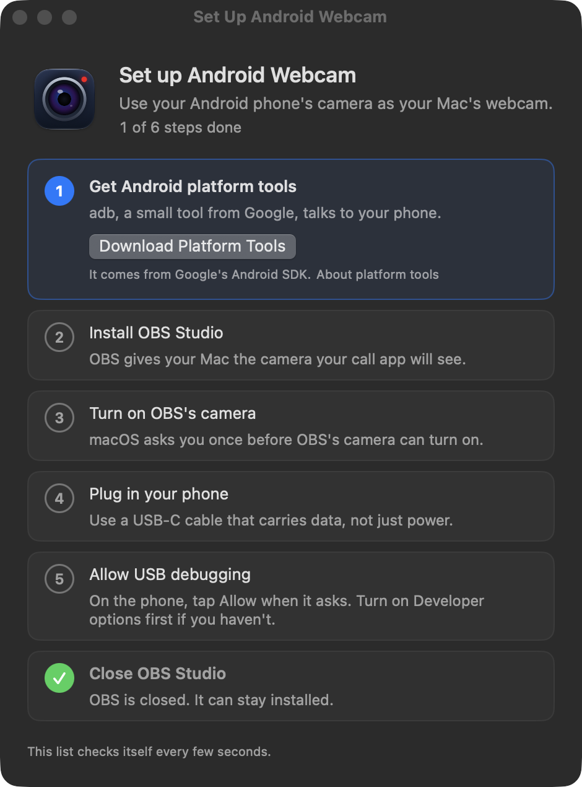

# Android Webcam

Use your Android phone's camera as your Mac's webcam, over a USB cable or Wi-Fi. There's no app to install on the phone, no account and no cloud: the Mac talks to the phone's camera directly and hands the picture to any call or recording app.

<p align="center">
  
  
</p>

It has run live with a Galaxy S25 Ultra into a video call and a QuickTime recording. Most menu, setup, error and reconnect paths have also been driven against an Android emulator; [docs/phone-session.md](docs/phone-session.md) lists what still needs a real phone.

## What you need

- A Mac on macOS 13 or later. Release builds run on Apple silicon and Intel Macs; only Apple silicon has been tried.
- An Android phone on Android 12 or later, and a USB cable that carries data (some charging cables don't).
- About 10 minutes the first time. Setup downloads the two free tools it needs for you:
  - **Android platform tools** from Google, which the Mac uses to talk to the phone (`adb`).
  - **OBS Studio**, for its virtual camera. OBS only has to be installed; it stays closed while you use the webcam.

## Get the app

There's no signed download yet. Build it yourself (see [Build](#build)), or download `Android-Webcam.dmg` from a [release](https://github.com/hkay-dev/android-webcam/releases). Open it, drag **Android Webcam** onto the **Applications** folder next to it, then eject the disk image. Open the app from Applications, not from the disk image or Downloads.

The app is ad-hoc signed and not notarized, so macOS blocks the first open:

1. Double-click the app. macOS says "“Android Webcam” Not Opened"; click **Done**.
2. Open **System Settings › Privacy & Security** (scroll down the sidebar to find it), then scroll to the bottom of the page. Next to "“Android Webcam” was blocked to protect your Mac", click **Open Anyway**. The button shows for about an hour after step 1.
3. In the "Open “Android Webcam”?" dialog, click **Open Anyway**. The password box takes a few seconds to appear; enter your password. The app opens and Setup appears.

Each new version is a new unsigned build, so you do this again after an update.

## First run

The app lives in the menu bar (a camera icon). The first time it opens, the setup window walks you through five steps. While Setup is open the app also has a Dock icon (it bounces when Setup is waiting behind another window), so you can get back to it from behind System Settings. When you close Setup the Dock icon goes, and macOS may say once that "Android Webcam" is running in the background: that's the menu bar app, as intended.

Click **Set Up for Me** and the app does steps 1 to 3 by itself, except for one approval macOS asks you for. You can set up the phone while it downloads. Each step also has its own button if you'd rather go one at a time.

1. **Get Android platform tools.** Google's adb, which talks to the phone. It goes into the app's own folder in Application Support, nothing system-wide. The app turns off adb's wireless phone search, so macOS shouldn't ask about local networks; if it does (another tool started adb first), **Don't Allow** is fine, USB doesn't need it.
2. **Install OBS Studio.** The app gets the latest release from OBS's GitHub page (about 150 MB), checks that the OBS Project signed it, and puts it in Applications. If you already have OBS, this step is done.
3. **Turn on OBS's camera.** The app starts OBS in the background (on a Mac where OBS has never run, it first sets OBS to skip its welcome windows). macOS asks about a new camera extension from OBS: click **Open System Settings**, click the switch next to OBS and type your password. If you closed that box, **Open Camera Extensions** in Setup gets you to the same switch. The app then quits OBS, reopens itself once, and moves on.
4. **Connect your phone.** Setup watches the USB port and shows what to do next, with a little phone acting out the taps:
   - Plug the phone in with a cable that carries data, not just power.
   - Turn on Developer options: in **Settings › About phone** (on Samsung, then **Software information**), tap **Build number** 7 times and enter your PIN. This unlocks settings for app developers; the webcam needs one of them, USB debugging, to read the camera directly.
   - In **Settings › Developer options** (on Samsung, at the bottom of Settings; on a Pixel, in **System**), turn on **USB debugging**.
   - The phone asks "Allow USB debugging?": tick **Always allow from this computer** and tap **Allow**.
5. **Close OBS Studio.** The app and OBS can't both feed the camera. OBS can stay installed.

Then click **Start Webcam**. In Zoom, Meet, FaceTime, Teams or QuickTime, choose **OBS Virtual Camera** as the camera.

## Using it

- **Start Webcam** and **Stop Webcam** are at the top of the menu once a phone is ready; until then that spot says **Finish Setup…** and the next step. The header shows the phone's name next to its status, how it's connected (USB or Wi-Fi), its temperature and battery, and the live picture. A warm phone or a low battery changes color; hover over it to see why. Each of Phone, Capture Mode, Orientation and Camera shows what's picked, and the menu bar icon turns red with the call's clock while you're live. Start, Stop and the choices in the submenus leave the menu open, so you see the picture come up or the check mark move; click the icon again or anywhere else to close it. With no phone on USB or Wi-Fi, the picture is a gray screen and the readings are dashes.
- **Capture Mode** picks 1080p at 30 fps (the default, and the coolest for the phone), 1080p at 60, 4K at 60, or an experimental 1080p at 120. Phones differ; if one can't run a mode, the app says so instead of quietly picking another.
- **Orientation** sets how you hold the phone. **Landscape** (the default) is sideways, and **Portrait** is upright, with the tall picture between black bars, since call apps always get a wide picture. Either way round works: the phone's motion sensor tells the app which way is up, so the picture never comes out upside down. **Auto-Rotate** follows the phone through all four turns, for walking around with it in your hand. It changes the live picture at once, from the menu or Live Controls. If Landscape is picked and you hold the phone upright, the menu and Live Controls mention it.
- **Live Controls** (⌃⌥⌘L from any app) opens a small floating panel that stays above your call and never takes its keyboard, so mute and push-to-talk keep working: switch lenses, zoom (hold to keep zooming), turn on the flashlight, pick the orientation, and set exposure, white balance, focus and sharpening while you're live. When the webcam is off it has a Start Webcam button. Settings stay for the next call.
- **Show Preview** opens a picture-only window, separate from what call apps see.
- **Check Audio Sync** times a clap to measure how far the video lags the sound, so you can set an audio delay in your call or recording app.
- **Phone › Connect a Phone over Wi-Fi…** pairs the phone once with a QR code: on the phone, open **Developer options › Wireless debugging**, tap **Pair device with QR code** and point it at the window (or type the phone's six-digit pairing code). After that the phone connects by itself whenever it's on the same Wi-Fi, and the menu shows a Wi-Fi or cable symbol next to each phone. **Settings › Phones over Wi-Fi** turns it off again. A cable keeps the phone charged and gives the steadiest picture; on Harsha's network, 4K at 60 still ran at 59 fps over Wi-Fi.
- **Settings** has Launch at login, Start when the phone is plugged in, notifications, Phones over Wi-Fi and the Live Controls shortcut. Its Help section has **Copy Diagnostics**, which copies a plain-text report (versions, Mac, adb, OBS, the phone's model, setup steps and recent errors, with serial numbers taken out) to paste into a bug report, **Run Setup Again**, and **Check for Updates**, which asks GitHub for the newest release and links to it.

<p align="center">
  
  
</p>

If the cable comes loose mid-call, the call keeps its camera and the picture comes back on its own when you plug the phone back in. If the phone runs hot, a notification offers to switch to 1080p at 30 fps.

### Why call apps say "OBS Virtual Camera"

The app sends its picture through OBS's camera, and OBS decides the name call apps show. A camera of the app's own, named after your phone, needs a camera extension signed with a paid Apple Developer ID, which this project doesn't have yet.

## When something's wrong

The menu says what happened and what to do next. The common ones:

| You see | Try |
| --- | --- |
| The phone isn't listed | Use a data cable, unlock the phone and tap Allow on the USB debugging prompt. If it says "connecting", unplug and plug it back in. |
| "Another app on the phone is using the camera" | Close the phone's camera app or any video call on the phone, then start again. |
| "The phone's camera can't …" this mode | Pick a lower Capture Mode. |
| Call apps don't list OBS Virtual Camera | Finish step 3 of Setup, then quit and reopen the call app. |
| The picture lags the sound | Run Check Audio Sync and set that delay on the audio in your app. |

Still stuck? See [Report a problem](#report-a-problem).

## Phones

Any phone on Android 12 or later with a back or front camera that Android's Camera2 API can open; the app checks the version and says so on older ones. Capture modes and lenses depend on the phone: a mode it can't run shows an error, and Live Controls lists the lenses the phone reports. It has been tried live on a Galaxy S25 Ultra only, so reports from other phones help.

## Report a problem

Open an issue at https://github.com/hkay-dev/android-webcam/issues; the bug form asks for the phone and the diagnostics. In **Settings › Help**, click **Copy Diagnostics** and paste the report into the issue. It has the versions, the phone's model, the setup steps and recent errors, with serial numbers taken out.

## Where files go

- `~/Library/Application Support/Android Webcam/platform-tools/`: the adb that Setup downloads.
- `~/Library/Application Support/com.harsha.android-webcam/session.json`: what the last session started, so the next launch can clean up after a crash.
- `~/Library/Preferences/com.harsha.android-webcam.plist`: settings.
- `~/Library/Caches/com.harsha.android-webcam` and `~/Library/HTTPStorages/com.harsha.android-webcam`: macOS's own download cache for Setup's downloads.
- `~/.android/adbkey` and `adbkey.pub`: adb's key, which your phone trusts. adb writes these, and any other Android tool on the Mac shares them.
- `/Applications/OBS.app`, if Setup installed OBS.
- On the phone, `/data/local/tmp/android-webcam-*.jar` while the webcam runs; the app removes it.

## Uninstall

1. Quit the app from its menu. If you turned on **Launch at login**, turn it off in Settings first.
2. Open Terminal and stop the adb server, which keeps running after the app quits:
   `"$HOME/Library/Application Support/Android Webcam/platform-tools/adb" kill-server`
   If it says "cannot connect to daemon", adb wasn't running, which is fine.
3. Delete the app and its files:
   ```sh
   rm -rf "/Applications/Android Webcam.app" "$HOME/Library/Application Support/Android Webcam" "$HOME/Library/Application Support/com.harsha.android-webcam" "$HOME/Library/Caches/com.harsha.android-webcam" "$HOME/Library/HTTPStorages/com.harsha.android-webcam"
   defaults delete com.harsha.android-webcam
   ```
4. If you don't use OBS otherwise, drag OBS to the Trash. Finder says OBS is hosting a system extension: click **Continue** and enter your password. The camera extension is fully gone after the next restart.
5. On the phone, open **Settings › Developer options**, tap **Revoke USB debugging authorizations**, and turn off USB debugging.

## Privacy

The app sends video only. It doesn't record, capture your screen or send anything to the Internet. It only goes online for the two setup downloads you click and when you click **Check for Updates**, which asks GitHub for the newest release number. It opens the microphone only while **Check Audio Sync** runs, to time a clap, and keeps nothing. It adds a login item only if you turn on **Launch at login**.

## Build

You need:

- Xcode 15 or later, or its Command Line Tools (`xcode-select --install`). The script uses the selected Xcode; set `DEVELOPER_DIR` to use another.
- A JDK 17 and the Android SDK's platform 36 and build-tools 36.0.0, to build the phone server (`scripts/build-server.sh`, see `server/README.md`). Android Studio's SDK Manager installs both. Without Android Studio, with Homebrew:

  ```sh
  brew install openjdk@17 android-commandlinetools
  export JAVA_HOME="$(brew --prefix openjdk@17)" ANDROID_HOME="$HOME/Library/Android/sdk"
  yes | sdkmanager --sdk_root="$ANDROID_HOME" "platforms;android-36" "build-tools;36.0.0"
  ```
- Network access the first time: the script clones scrcpy v5.0.1 from GitHub.

Set `SCRCPY_SERVER_PATH` to bundle another server jar instead; its version must be `5.0.1-webcam.1`.

```sh
./scripts/build-app.sh
```

The app is written to `build/Android Webcam.app` and signed locally with an ad-hoc signature. `UNIVERSAL=1` builds one binary for Apple silicon and Intel, and `scripts/make-dmg.sh` packs the app into `build/Android-Webcam.dmg`. CI builds on pushes to `main` and pull requests, and a `v*` tag publishes the DMG and a zip as a GitHub release, stamped with the tag's version.

## How it works

ADB starts this project's build of scrcpy-server 5.0.1 on the phone. A local ADB forwarding socket carries framed HEVC packets, and a second socket carries camera controls one way and the phone's orientation the other. VideoToolbox decodes the video to NV12 pixel buffers, an optional Core Image step sharpens them and turns them upright, and CoreMediaIO sends them directly to the OBS extension's sink stream. The preview shows the same frames, and its size never changes what call apps get. There's no scrcpy desktop window or OBS scene in this path.

The app learns about phones from one long-running `adb track-devices -l` client, which reports each plug-in, unplug and USB debugging approval as it happens. While the webcam runs, the app holds an activity assertion that keeps App Nap from slowing the frame path; it doesn't stop the Mac from sleeping.

The app owns its temporary server file, forwarding entry and child process. Stop and Quit clean up only those, and the next launch removes what a killed session left. It never stops the shared ADB server.

The app looks for `adb` in `$ADB`, `$ANDROID_HOME`, `$ANDROID_SDK_ROOT`, `~/Library/Android/sdk`, the copy Setup downloads (`~/Library/Application Support/Android Webcam/platform-tools`), `/opt/homebrew/bin` and `/usr/local/bin`. The three environment variables only count when you start the app from a shell (as the headless checks do); opened from Finder it uses the fixed paths.

### Modes

- 4K at 60 fps, HEVC at 40 Mbps.
- 1080p at 60 fps, HEVC at 20 Mbps.
- 1080p at 30 fps, HEVC at 12 Mbps.
- 1080p at 120 fps, experimental high-speed capture at 40 Mbps.

The requested size is checked against the server's session metadata. The stock OBS extension advertises 1080p60 even when it gets 4K buffers, and this app inherits that.

### Headless checks

These don't create the menu bar item, open a window, start the phone's camera or publish to the virtual camera.

```sh
'build/Android Webcam.app/Contents/MacOS/AndroidWebcam' --diagnose
'build/Android Webcam.app/Contents/MacOS/AndroidWebcam' --probe-hevc path/to/sample.hevc
```

`--diagnose` checks USB device discovery, the bundled server and the OBS extension's device identity. It also reports the Phones over Wi-Fi switch (see [docs/wireless-latency-session.md](docs/wireless-latency-session.md)). `--probe-hevc` checks the hardware decoder with an Annex B HEVC sample.

To walk the menu and every window without a VM and without anything showing on screen, run the app as an off-screen dev instance with `scripts/dev.sh`, and stand in for a phone with an emulator and `scripts/fault-adb`. See [docs/dev-automation.md](docs/dev-automation.md).

## Dependencies and references

The bundled server is [scrcpy](https://github.com/Genymobile/scrcpy/tree/v5.0.1) 5.0.1, Apache-2.0 software from Genymobile, built from source with this project's patch in `server/webcam.patch`. Its license is included in the app's resources. Its [5.0.1 server protocol](https://github.com/Genymobile/scrcpy/blob/v5.0.1/server/src/main/java/com/genymobile/scrcpy/device/Streamer.java) is unchanged apart from the additions in `server/README.md`.

The [pyvirtualcam macOS backend](https://github.com/letmaik/pyvirtualcam/tree/main/pyvirtualcam/native_macos_obs_cmioextension) documents the OBS sink-stream route. This app uses native CoreMediaIO APIs and doesn't include a Python runtime.

Android Webcam is licensed under Apache-2.0 (see `LICENSE` and `NOTICE`).
