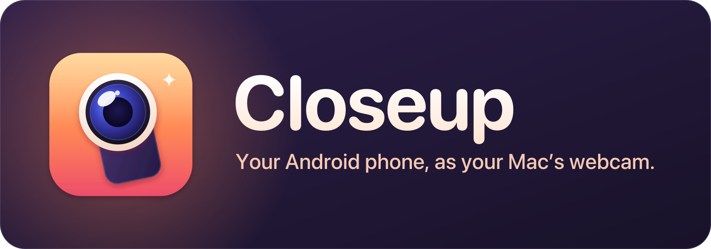

<p align="center">
  
</p>

<p align="center">
  <strong>Use your Android phone's camera as your Mac's webcam, over USB or Wi-Fi.</strong>
</p>

<p align="center">
  
  
  <a href="LICENSE"></a>
</p>

Closeup is a small menu bar app for the Mac. Plug in your phone, click **Start Webcam**, and pick **OBS Virtual Camera** in Zoom, Meet, FaceTime, Teams or QuickTime. There's no app to install on the phone, no account and no cloud.

<p align="center">
  
  &nbsp;
  
</p>

## Get started

1. Download [Closeup.dmg](https://github.com/hkay-dev/closeup/releases/latest/download/Closeup.dmg) from the newest [release](https://github.com/hkay-dev/closeup/releases) and drag **Closeup** into **Applications**.
2. The app isn't notarized yet, so macOS blocks the first open. [Install](site/content/%2801-get-started%29/install.mdx) shows how to let it through.
3. Open it. Setup gets the two free tools it needs (Google's platform tools and OBS Studio) and walks you through turning on USB debugging on the phone.

You need a Mac on macOS 13 or later and an Android phone on Android 12 or later.

## Docs

The full guide is the docs site in [`site/`](site):

- **Get started:** [What you need](site/content/%2801-get-started%29/requirements.mdx), [Install](site/content/%2801-get-started%29/install.mdx), [First run](site/content/%2801-get-started%29/setup.mdx)
- **Using Closeup:** [The menu bar](site/content/%2802-using%29/menu.mdx), [Capture mode and orientation](site/content/%2802-using%29/picture.mdx), [Live Controls](site/content/%2802-using%29/live-controls.mdx), [Check Audio Sync](site/content/%2802-using%29/audio-sync.mdx), [Wi-Fi](site/content/%2802-using%29/wifi.mdx), [Settings](site/content/%2802-using%29/settings.mdx)
- **Help:** [Troubleshooting](site/content/%2803-help%29/troubleshooting.mdx), [Privacy and files](site/content/%2803-help%29/privacy.mdx), [Uninstall](site/content/%2803-help%29/uninstall.mdx)
- **For developers:** [Build from source](site/content/%2804-developers%29/build.mdx), [How it works](site/content/%2804-developers%29/how-it-works.mdx), [Credits and license](site/content/%2804-developers%29/credits.mdx)

Found a bug? [Open an issue](https://github.com/hkay-dev/closeup/issues) and paste the report from **Settings › Help › Copy Diagnostics**.

## Build

```sh
./scripts/build-app.sh
```

That writes `build/Closeup.app`. It needs Xcode 15 or later, a JDK 17 and the Android SDK; [Build from source](site/content/%2804-developers%29/build.mdx) has the details.

## License

Apache-2.0. Closeup builds on [scrcpy](https://github.com/Genymobile/scrcpy) and uses [OBS Studio](https://obsproject.com)'s virtual camera. See [LICENSE](LICENSE) and [NOTICE](NOTICE).
