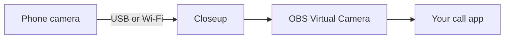

Plug in your phone, click **Start Webcam**, and pick **OBS Virtual Camera** in Zoom, Meet, FaceTime, Teams or QuickTime. There's no app to install on the phone, no account and no cloud. The Mac talks to the phone's camera directly and hands the picture to any call or recording app.

## What you get

- **It lives in the menu bar.** The menu's header shows the phone's name and status, how it's connected (USB or Wi-Fi), its temperature and battery, and the live picture. The menu bar icon turns red with the call's clock while you're live.
- **You pick the picture.** 1080p at 30 or 60 fps, 4K at 60, or an experimental 1080p at 120. Landscape, Portrait or Auto-Rotate, and it never comes out upside down.
- **Live Controls.** A small floating panel for lenses, zoom, flashlight, exposure, white balance, focus and sharpening. Open it from any app with <kbd>⌃</kbd> <kbd>⌥</kbd> <kbd>⌘</kbd> <kbd>L</kbd>.
- **Check Audio Sync.** Clap once and it tells you how far the video is behind the sound.
- **It sets itself up.** Setup downloads Google's platform tools and OBS Studio and turns on OBS's camera for you.
- **It works over Wi-Fi too.** Pair the phone once with a QR code and it connects by itself after that.
- **It keeps going.** If the cable comes loose mid-call, the call keeps its camera and the picture comes back when you plug the phone in again.

## How the picture gets to your call

Closeup starts its own build of the [scrcpy](https://github.com/Genymobile/scrcpy) server on the phone, gets the camera's video back, decodes it in hardware on the Mac and writes the frames straight into OBS's virtual camera. OBS has to be installed for its camera, but it stays closed. There's no scrcpy window and no OBS scene in the way. [How it works](/how-it-works) has the details.

## Where it stands

Closeup has run live with a Galaxy S25 Ultra into a video call and a QuickTime recording. Most menu, setup, error and reconnect paths have also been run against an Android emulator. It has been tried on that one phone only, so reports from other phones help.

<CardGroup cols={2}>
  <Card title="What you need" href="/requirements" icon="list-checks">
    A Mac, an Android phone and a data cable.
  </Card>
  <Card title="Install" href="/install" icon="download">
    Get the app and open it the first time.
  </Card>
</CardGroup>
