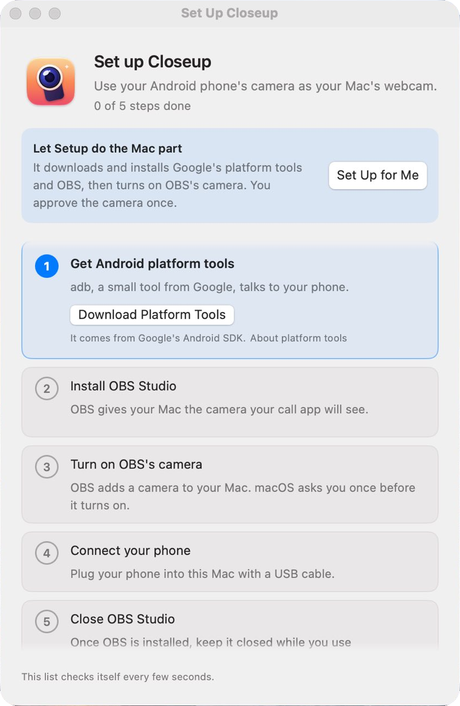

The app lives in the menu bar, as a camera icon. The first time it opens, the Setup window walks you through five steps.

<Frame caption="Setup checks each step by itself every few seconds.">
  
</Frame>

Click **Set Up for Me** and the app does steps 1 to 3 by itself, except for one approval that macOS asks you for. You can set up the phone while it downloads. Each step also has its own button if you'd rather go one at a time.

<Steps>
  <Step title="Get Android platform tools">
    This is Google's `adb`, which talks to the phone. It goes into the app's own folder in Application Support, nothing system-wide. The app turns off adb's wireless phone search, so macOS shouldn't ask about local networks. If it does (another tool started adb first), **Don't Allow** is fine. USB doesn't need it.
  </Step>
  <Step title="Install OBS Studio">
    The app gets the latest release from OBS's GitHub page (about 150 MB), checks that the OBS Project signed it, and puts it in Applications. If you already have OBS, this step is done.
  </Step>
  <Step title="Turn on OBS's camera">
    The app starts OBS in the background. On a Mac where OBS has never run, it first sets OBS to skip its welcome windows. macOS asks about a new camera extension from OBS: click **Open System Settings**, click the switch next to OBS and type your password. If you closed that box, **Open Camera Extensions** in Setup gets you to the same switch. The app then quits OBS, reopens itself once, and moves on.
  </Step>
  <Step title="Connect your phone">
    Setup watches the USB port and shows what to do next, with a little phone acting out the taps:

    - Plug the phone in with a cable that carries data, not just power.
    - Turn on Developer options. In **Settings › About phone** (on Samsung, then **Software information**), tap **Build number** 7 times and enter your PIN. This unlocks settings for app developers. The webcam needs one of them, USB debugging, to read the camera directly.
    - In **Settings › Developer options** (on Samsung, at the bottom of Settings; on a Pixel, in **System**), turn on **USB debugging**.
    - The phone asks "Allow USB debugging?". Tick **Always allow from this computer** and tap **Allow**.
  </Step>
  <Step title="Close OBS Studio">
    The app and OBS can't both feed the camera. OBS can stay installed.
  </Step>
</Steps>

Then click **Start Webcam**. In Zoom, Meet, FaceTime, Teams or QuickTime, choose **OBS Virtual Camera** as the camera.

## The Dock icon

While Setup is open, the app also has a Dock icon, so you can get back to it from behind System Settings. It bounces when Setup is waiting behind another window. When you close Setup the Dock icon goes away, and macOS may say once that "Closeup" is running in the background. That's the menu bar app, as intended.

Setup can be opened again any time from **Settings › Help › Run Setup Again**.
