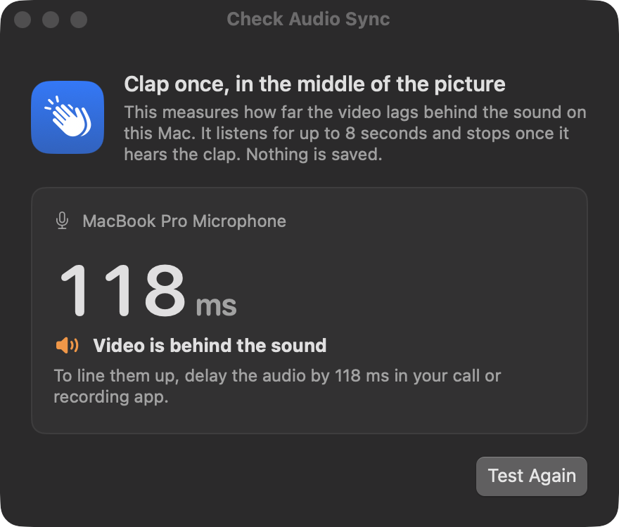

Video from a phone arrives a little after the sound from your Mac's microphone. **Check Audio Sync** measures the gap so that you can fix it in your call or recording app.

<Frame>
  
</Frame>

<Steps>
  <Step title="Start the webcam">
    The check times the live picture, so the webcam has to be running.
  </Step>
  <Step title="Open Check Audio Sync">
    Choose **Check Audio Sync…** in the menu.
  </Step>
  <Step title="Clap once">
    Clap in the middle of the picture. It listens for up to 8 seconds and stops once it hears the clap.
  </Step>
  <Step title="Delay the audio">
    It tells you how far the video is behind the sound. Set that delay on the audio in your call or recording app.
  </Step>
</Steps>

The microphone is only open while the check runs, and nothing is saved.
