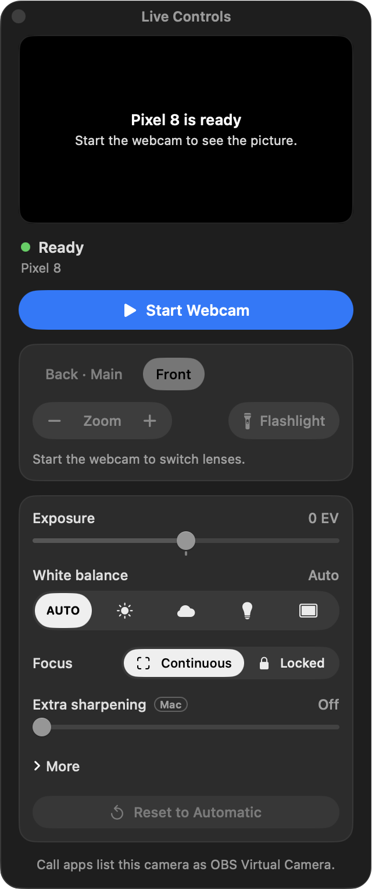

Press <kbd>⌃</kbd> <kbd>⌥</kbd> <kbd>⌘</kbd> <kbd>L</kbd> from any app, or choose **Live Controls…** in the menu. A small panel opens that stays above your call and never takes its keyboard, so mute and push-to-talk keep working.

<Frame caption="Live Controls before the webcam starts. The lens chips and zoom turn on once it's live.">
  
</Frame>

From the panel you can:

- switch lenses (it lists the lenses that the phone reports),
- zoom, and hold the button to keep zooming,
- turn on the flashlight,
- pick the [orientation](/picture#orientation),
- set exposure, white balance, focus and extra sharpening.

When the webcam is off, the panel has a **Start Webcam** button. Your settings stay for the next call, and **Reset to Automatic** puts them back.

The shortcut works even when the call is in full screen. You can turn it off in **Settings › Live Controls**.
