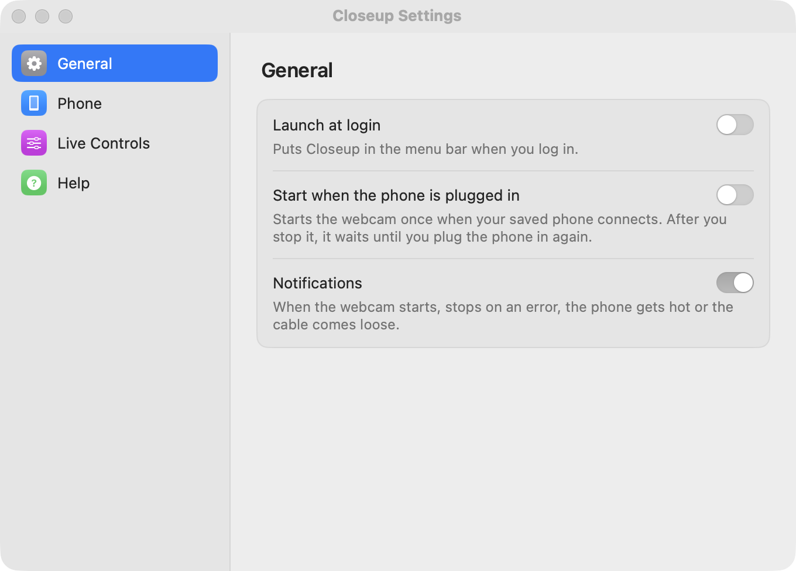

Open **Settings…** from the menu.

<Frame>
  
</Frame>

## General

- **Launch at login** puts Closeup in the menu bar when you log in. It's off until you turn it on.
- **Start when the phone is plugged in** starts the webcam once when your saved phone connects. After you stop it, it waits until you plug the phone in again.
- **Notifications** tell you when the webcam starts, stops on an error, the phone gets hot or the cable comes loose.

## Phone

- **Phones over Wi-Fi** lists phones that have Wireless debugging on, next to the ones on USB.
- **Connect a phone over Wi-Fi** pairs this Mac with a phone once, with a QR code. See [Wi-Fi](/wifi).

## Live Controls

**Keyboard shortcut** turns <kbd>⌃</kbd> <kbd>⌥</kbd> <kbd>⌘</kbd> <kbd>L</kbd> on or off. It opens and closes [Live Controls](/live-controls) from any app, even a call in full screen.

## Help

- **Copy Diagnostics** copies a plain-text report to paste into a bug report: versions, the Mac, adb, OBS, the phone's model, setup steps and recent errors, with serial numbers taken out.
- **Run Setup Again** opens [Setup](/setup).
- **Check for Updates** asks GitHub for the newest release and links to it.
