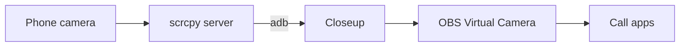

The server on the phone is this project's patched build of scrcpy. adb carries its video over USB or Wi-Fi.

## The video path

adb starts this project's build of scrcpy-server 5.0.1 on the phone. A local adb forwarding socket carries framed HEVC packets, and a second socket carries camera controls one way and the phone's orientation the other.

On the Mac, VideoToolbox decodes the video to NV12 pixel buffers. An optional Core Image step sharpens them and turns them upright, and CoreMediaIO sends them directly to the OBS extension's sink stream. The preview shows the same frames, and its size never changes what call apps get.

| Mode | Video |
| --- | --- |
| 4K at 60 fps | HEVC at 40 Mbps |
| 1080p at 60 fps | HEVC at 20 Mbps |
| 1080p at 30 fps | HEVC at 12 Mbps |
| 1080p at 120 fps | Experimental high-speed capture at 40 Mbps |

The requested size is checked against the server's session metadata. The stock OBS extension advertises 1080p60 even when it gets 4K buffers, and this app inherits that.

## Finding phones

The app learns about phones from one long-running `adb track-devices -l` client, which reports each plug-in, unplug and USB debugging approval as it happens.

While the webcam runs, the app holds an activity assertion that keeps App Nap from slowing the frame path. It doesn't stop the Mac from sleeping.

## Cleaning up

The app owns its temporary server file, forwarding entry and child process. Stop and Quit clean up only those, and the next launch removes what a killed session left. It never stops the shared adb server.

## Where it looks for adb

The app looks for `adb` in this order:

1. `$ADB`, `$ANDROID_HOME` and `$ANDROID_SDK_ROOT`
2. `~/Library/Android/sdk`
3. The copy that Setup downloads, in `~/Library/Application Support/Closeup/platform-tools`
4. `/opt/homebrew/bin` and `/usr/local/bin`

The three environment variables only count when you start the app from a shell, as the headless checks do. Opened from Finder, it uses the fixed paths.

The phone server's protocol changes are listed in the repository's `server/README.md`.
